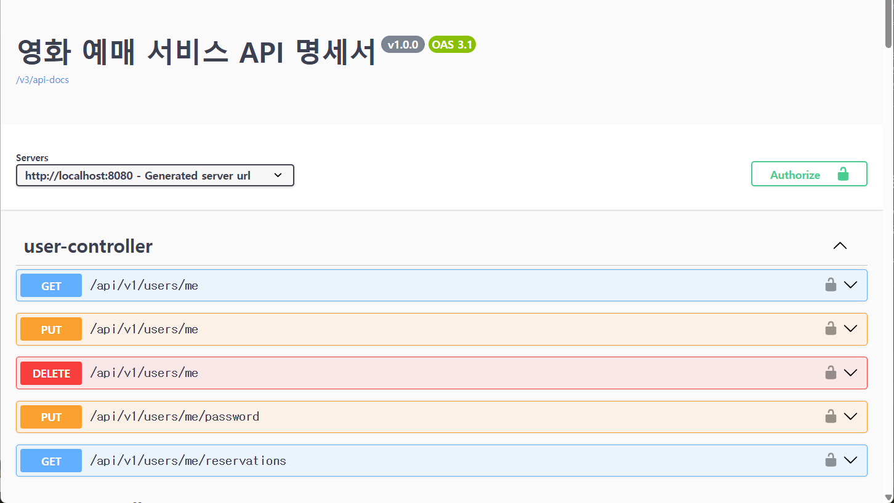

# 🎬 영화 예매 시스템 (Movie Reservation System)

선착순 티켓팅 시 순간적으로 집중되는 트래픽 스파이크와 고동시성 환경을 가정하고, **성능 최적화와 동시성 제어, 데이터 정합성 보장**에 중점을 두어 개발한 백엔드 프로젝트입니다.

## 🛠 Tech Stack

**Backend**
- Java 17
- Spring Boot 4.1
- Spring Data JPA
- Spring Security
- JWT (jjwt 0.11)

**Database & Cache**
- MySQL
- Redis (Spring Cache, Redisson 4.3)
- H2 (Test Database)

**Test & Docs**
- JUnit 5
- k6 (Load Testing)
- SpringDoc OpenAPI (Swagger 2.8)

**External API**
- TMDB API (영화 상세 정보 및 이미지)
- KOFIC API (영화진흥위원회 일별 박스오피스)
- PortOne API (결제 연동)

---

## 🔥 핵심 트러블슈팅 및 성능 개선

### 1. 16.5배의 TPS 향상: 트래픽 스파이크 대비 조회 성능 최적화
- **문제:** 티켓팅 오픈 시 메인 페이지(현재 상영작 목록)에 접속자가 몰리며 DB 커넥션 풀 고갈 및 심각한 지연(p95 4.38초) 발생.
- **해결:**
    - `Schedule` 테이블 검색 속도 개선을 위해 복합 인덱스 적용.
    - Spring Cache와 Redis를 활용해 영화 목록 데이터를 **글로벌 캐싱**하여 DB 접근 부하 차단.
    - 인프라 처리량 증가에 맞춰 Tomcat 스레드 풀(max: 400) 및 Accept-Count(300) 최적화.
- **결과:** 초당 처리량(TPS) **112/s ➡ 1,853/s 로 약 16.5배 향상**, 응답 지연(p95) 93% 단축 완료.

### 2. 에러율 0%: 다중 좌석 선착순 예매 동시성 제어 및 데드락 해결
- **문제:** 다수의 사용자가 동시에 동일 좌석 예매 시 비관적 락(Pessimistic Lock) 환경에서 초과 예매(Overbooking) 버그 확인 및 다중 좌석 예매 시 데드락(11초 지연) 현상 발견.
- **해결:**
    - 데이터 무결성 최후 방어선으로 `ReservationSeat`에 Unique 제약조건(`schedule_id`, `seat_id`) 적용.
    - 무의미한 락 대기를 없애기 위해 **Redisson MultiLock 기반의 분산 락** 도입.
    - `tryLock(0, 10, TimeUnit.SECONDS)` 설정을 통해 락 획득 실패 시 대기 없이 즉시 예외 처리(Fail-Fast) 하도록 개선.
- **결과:** VUs 100 규모의 동일 좌석 경쟁 부하 테스트에서 **초과 예매 0건, 데드락 발생 0%** 달성 및 승자 1명을 제외한 요청은 평균 1초 내 즉각 튕겨내어 무중단 서비스 검증.

### 3. 데이터 정합성 보장: 결제 타임아웃 및 자원 롤백
- **문제:** 선착순 예매 성공 후 결제 이탈자가 발생할 경우, 다른 사용자가 해당 좌석을 영구적으로 예매할 수 없는 자원 낭비 발생.
- **해결:**
    - 예매의 라이프사이클을 `PENDING(결제 대기)`, `CANCELED(취소)`, `COMPLETED(완료)`로 분리하여 상태 머신 설계.
    - **Spring Scheduler**를 활용하여 예매 후 10분 내 결제 미완료 시 상태를 `CANCELED`로 변경하고 좌석 점유를 해제하는 자원 회수 로직 구현.

---

## ⚙️ 주요 비즈니스 로직
- **회원 인증:** Spring Security와 JWT를 활용한 Stateless 인증/인가 처리.
- **외부 데이터 동기화:** TMDB 및 영화진흥위원회 API를 주기적으로 호출하여 최신 영화 정보 자동 갱신.
- **결제 연동:** PortOne API를 이용한 결제 검증 및 예매 확정 처리.

---

## 📄 API 명세서

<b>🔍 전체 API 명세표</b>

| 도메인 | HTTP Method | API URI | 설명 |
| :--- | :---: | :--- | :--- |
| **Auth** | `POST` | `/api/v1/auth/signup` | 회원가입 |
| | `POST` | `/api/v1/auth/login` | 로그인 |
| | `POST` | `/api/v1/auth/logout` | 로그아웃 |
| | `POST` | `/api/v1/auth/reissue` | JWT 토큰 재발급 |
| **User** | `GET` | `/api/v1/users/me` | 내 프로필 조회 |
| | `PUT` | `/api/v1/users/me` | 프로필 정보 수정 |
| | `PUT` | `/api/v1/users/me/password` | 비밀번호 변경 |
| | `DELETE` | `/api/v1/users/me` | 회원 탈퇴 |
| | `GET` | `/api/v1/users/me/reservations` | 내 예매 내역 조회 |
| **Asset** | `GET` | `/api/v1/users/me/assets` | 내 자산(지갑/쿠폰) 조회 |
| | `POST` | `/api/v1/users/me/assets/wallet/charge` | 지갑 잔액 충전 |
| | `POST` | `/api/v1/users/me/assets/coupons/{couponId}` | 쿠폰 발급 |
| **Movie** | `GET` | `/api/v1/movies` | 전체 영화 목록 조회 |
| | `GET` | `/api/v1/movies/now-playing` | 현재 상영작 목록 조회 |
| | `GET` | `/api/v1/movies/{movieId}` | 영화 상세 정보 조회 |
| **Schedule** | `GET` | `/api/v1/movies/{movieId}/schedules` | 특정 영화의 스케줄 조회 |
| | `GET` | `/api/v1/schedules/{scheduleId}/seats` | 특정 스케줄의 잔여 좌석 조회 |
| **Reservation**| `POST` | `/api/v1/reservations` | 선착순 좌석 예매 생성 |
| | `GET` | `/api/v1/reservations/{reservationNo}` | 예매 단건 상세 조회 |
| | `POST` | `/api/v1/reservations/{reservationNo}/cancel` | 예매 취소 |
| | `GET` | `/api/v1/reservations/me/tickets/upcoming` | 다가오는 모바일 티켓 조회 |
| **Payment** | `POST` | `/api/v1/payments/verify` | 결제 승인 및 검증 |
| | `POST` | `/api/v1/payments/refund/{reservationId}` | 결제 환불 처리 |
| **Theater** | `GET` | `/api/v1/theaters` | 상영관 목록 조회 |
| **Coupon** | `GET` | `/api/v1/coupons` | 전체 쿠폰 목록 조회 |
| **Admin** | `POST` | `/api/v1/admin/movies/sync` | 영화 데이터 동기화 (외부 API) |
| | `POST` | `/api/v1/admin/schedules/auto-generate` | 스케줄 자동 생성 |
| | `POST` | `/api/v1/admin/coupons` | 관리자 쿠폰 생성 |
| | `POST` | `/api/v1/admin/users/{userId}/coupons/{couponId}` | 특정 유저에게 쿠폰 지급 |
| | `GET` | `/api/v1/admin/theaters/options` | 관리자용 상영관 옵션 조회 |
| | `GET` | `/api/v1/admin/movies/options` | 관리자용 영화 옵션 조회 |

